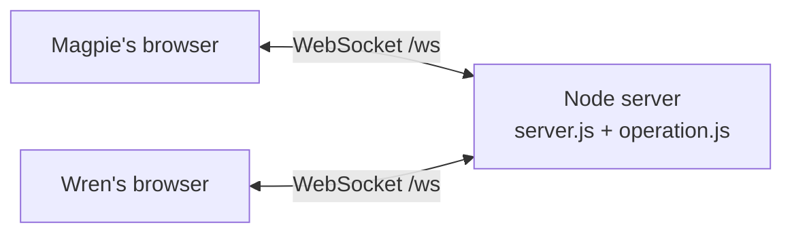
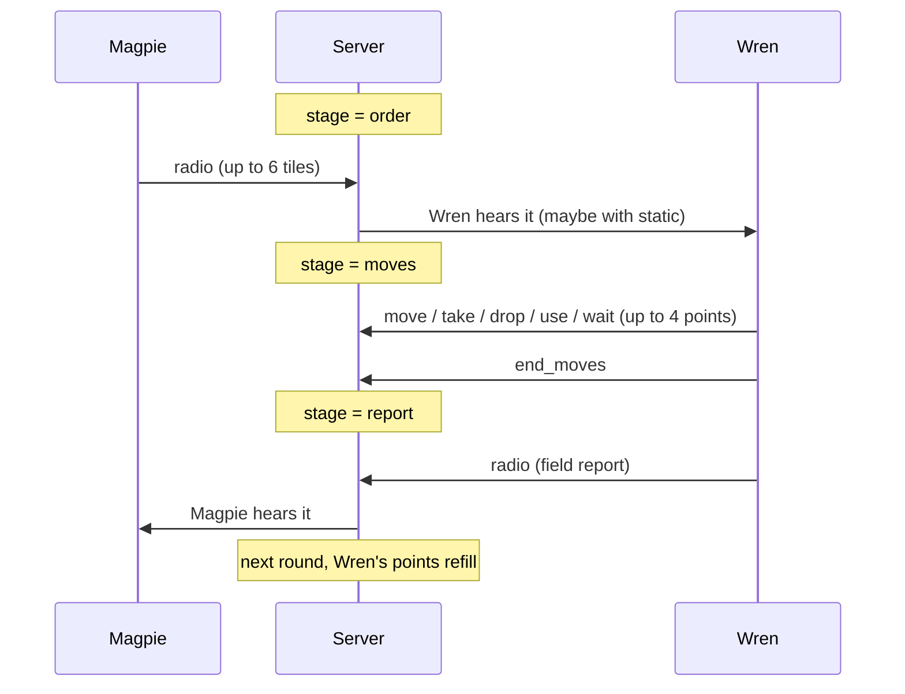
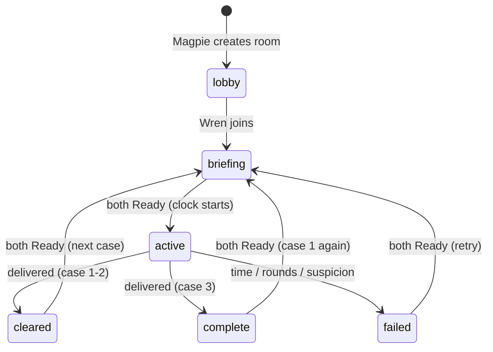
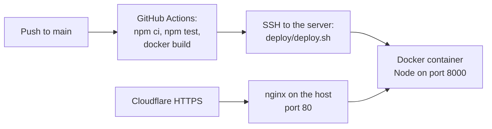

# How Lost in Transmission works

This guide explains the whole project: the game rules, how the code is split, what the browser and server say to each other, and how a push to `main` ends up live at https://transmission.michaelrbparker.com.

For setup commands, see the [README](../README.md). For a function-by-function guide to the code, see the [code reference](CODE.md).

## Contents

1. [The big picture](#the-big-picture)
2. [Files](#files)
3. [The game rules](#the-game-rules)
4. [ECHO and the radio](#echo-and-the-radio)
5. [Rooms and reconnecting](#rooms-and-reconnecting)
6. [Messages between browser and server](#messages-between-browser-and-server)
7. [The browser client](#the-browser-client)
8. [The server](#the-server)
9. [Tests](#tests)
10. [Build and deploy](#build-and-deploy)
11. [Changing things](#changing-things)

## The big picture

Two players open the same website. One creates a room and becomes **Magpie**, the handler. The other joins with the room code or scans its QR code and becomes **Wren**, the agent. They can't talk to each other in the game. Everything goes through a radio made of word tiles, and an enemy listener called **ECHO** turns repeated words into static.



- **The server owns the game.** All rules live in `operation.js` on the server. Browsers only send requests ("move up", "send these tiles") and draw whatever the server sends back. A player can't cheat by editing their browser, because the server checks every action.
- **Each player gets their own view.** After every change, the server sends each player a *snapshot* of the game, cut down to what that role is allowed to see. Wren's snapshot never contains the full map.
- **Nothing is saved to disk.** Rooms and ECHO's memory live in the server's memory. Restarting the server (for example, a deploy) ends every game in progress.

## Files

| File | What it does |
|---|---|
| `server.js` | Web server. Serves the page and files, runs the `/ws` WebSocket, and manages rooms. |
| `operation.js` | The game rules: turns, moves, suspicion, ECHO, scoring, and what each player can see. Also loads and checks the levels. |
| `levels/*.json` | One file per case: briefing, items, map, guard route, and a solution the tests play. |
| `web/index.html` | The page. Also holds the "close room" dialog and the how-to-play tutorial. |
| `web/game.js` | Browser logic: connects to the server, handles clicks and keys, the clock, copy, and the tutorial. |
| `web/screens.js` | Builds each screen (lobby, briefing, play screens, debrief) from the latest snapshot. |
| `web/radio.js` | The word list, message size limit and call signs. Shared by browser **and** server. |
| `web/style.css` | All styling, including the tutorial animations. |
| `web/assets/` | Fonts and art. |
| `web/logo.jpg`, `favicon.png`, `apple-touch-icon.png` | Logo for link previews, and browser and phone icons. |
| `test/` | Automated tests (`npm test`). |
| `Dockerfile`, `docker-compose.yml` | How the server is packaged and run on the host. |
| `deploy/` | The deploy script and the nginx config on the host. |
| `.github/workflows/build.yml` | Tests, builds and deploys on every push. |

## The game rules

### The cases

| # | Name | Package → destination | Decoy | Interference |
|---|---|---|---|---|
| 1 | Dead Drop | briefcase → fountain | umbrella | Light |
| 2 | The Courier | envelope → station | paper | Moderate |
| 3 | Dead Air | recording → park | paper | Heavy |
| 4 | Safe Deposit | key → bank | umbrella | Moderate (6×6, 5 rounds, 6 minutes) |
| 5 | Negatives | film → tower | paper | Heavy (10×8, 5 points a round) |
| 6 | Missed Connection | passport → station | envelope | Light (7×9, 7 rounds, 7 minutes) |
| 7 | The Bridge | cipher → bridge | paper | Severe (10×10, 5 points a round, 9 minutes) |
| 8 | Last Transmission | recording → embassy | umbrella | Severe (9×9, up to 3 static tiles) |

The briefings tell one story: the ECHO recording from Dead Air points to a mole inside the bureau, and each case follows that thread until ECHO is silenced at the embassy.

Each case is one JSON file in `levels/`, played in filename order. Its street map is written as lines of text, one per row. The first three cases are 8×8, later ones range from 6×6 to 10×10, and a level can be anywhere from 5×5 to 12×12:

| Letter | Meaning |
|---|---|
| `.` | Street |
| `#` | Wall (Wren can't move here) |
| `S` | Wren's starting point |
| `D` | The package (labelled CAFÉ) |
| `X` | The decoy (also labelled CAFÉ, so it can be mistaken for the package) |
| `E` | The drop point. Deliver the package here. |
| `P`, `T` | Park and station landmarks. Only labels, to help describe places over the radio. |

Each case also has a guard **patrol route**: a list of squares the guard walks forward and back along.

The "Interference" label is shown on the briefing screen. How hard ECHO actually jams is set by each level's `echoChance` and `echoMaxStatic` (see [ECHO](#echo-and-the-radio)), which the built-in levels match to their label.

### Limits

These are the defaults. Each level file can change them (see [Extending the game](EXTENDING.md#add-a-new-level)).

| Rule | Default | Set by |
|---|---|---|
| Time per case | 15 minutes | `minutes` in the level file |
| Rounds per case | 8 | `rounds` in the level file |
| Wren's action points per round | 4 | `actionPoints` in the level file |
| Tiles per message | 1 to 6 | `MESSAGE_LIMIT` in `web/radio.js` |

### What each player sees

- **Magpie:** the whole map, the guard's patrol route, the objective, and a "CCTV" note of where the guard last spotted Wren. Magpie does **not** see Wren's live position.
- **Wren:** only the 3×3 squares around themselves. Everything else shows as unknown. Wren also sees the guard if the guard is within those 3×3 squares, plus their bag and action points.

This is done in `Room.snapshot(role)`, which builds a separate message for each player.

### A round

Each round has three stages, stored in `room.stage`:



1. **Order:** Magpie sends a message of up to 6 word tiles.
2. **Moves:** Wren spends up to 4 action points, then presses *End moves*. Points don't carry over.
3. **Report:** Wren sends a message back, and the round number goes up.

If Wren's report in round 8 goes out without the package delivered, the case fails.

### Wren's actions

Every action costs one point:

| Action | What happens |
|---|---|
| Move | One square up, down, left or right. Not into a wall or off the map. |
| Take | Picks up the package or decoy if Wren is standing on it. Only one item fits in the bag. Taking the decoy adds **+15 suspicion**. |
| Drop | Drops the item where Wren stands. Dropping the package on the drop point **delivers it and wins the case**. |
| Use | Uses the decoy to blend in: **−15 suspicion**, and the decoy is used up. |
| Wait | Does nothing except spend a point, which moves the guard on. |

The E key does *take* if the bag is empty and *drop* if not.

### The guard and suspicion

- The guard takes one step along the patrol route **every time Wren spends a point**. Delivering the package is the one action that doesn't move the guard.
- After each step, if the guard is next to Wren or on the same square, Wren is **spotted**: **+25 suspicion**, at most once per round. Every sighting also updates Magpie's CCTV note.
- Suspicion goes from 0 to 100. **At 100, the case fails** ("Cover blown").

### How a case ends

| Outcome | Cause | What *Ready* does next |
|---|---|---|
| Cleared | Package delivered in case 1 or 2 | Starts the next case |
| Complete | Package delivered in case 3 | Replays from case 1 and **wipes ECHO's memory** |
| Failed | Time ran out, 8 rounds used up, or suspicion hit 100 | Retries the same case (ECHO keeps its memory) |

Both players must press *Ready* to start a case and to go on after the debrief.

The debrief shows:
- The **signal score**: the percentage of all tiles sent this case that weren't turned to static.
- The peak suspicion.
- The **worst intercept**: the message with the most static.
- A full transmission log of what was sent and what was heard.

## ECHO and the radio

ECHO is the enemy listener. It learns the words you use and jams them. The code is `Room.transmit` in `operation.js`.

When a message is sent, the server works through these steps:

1. Take the **different words** in the message. A word that appears twice in one message counts once.
2. A word is **learned** once it has appeared in **2 or more earlier messages**, from either player.
3. **Roll for each learned word.** Its chance of being jammed is the level's `echoChance` × (times used − 1), up to 60%. In Dead Air (`echoChance` 0.3), a word used twice before has a 30% chance, used three times 60%, and never more.
4. **Cap the damage.** Going left to right, tiles of jammed words become `[STATIC]` until the message hits its limit: the level's `echoMaxStatic` (1 in Dead Drop, 2 in the others), and never more than half the message (but at least 1).
5. Only then add this message's words to ECHO's memory.

For example, in case 1, Magpie sends `GO NORTH` and then `GO EAST`. Now GO has been used twice, so if the next message is `GO WEST 2`, there's a 20% chance Wren hears `[STATIC] WEST 2`. The more GO is used, the more likely it gets jammed.

ECHO's memory (`room.words`) **halves** when you move on to the next case, so a new case doesn't start with everything already learned. A retry keeps it all. It's wiped completely when the campaign is replayed.

In a simulation of typical play, this jams about 6% of tiles in case 1, 16% in case 2 and 22% in case 3, and never blanks a whole message. (The old fixed rule jammed 15%, 53% and 74%, wiping out several whole messages per case.)

The roll uses a random function passed into `Room` (`Math.random` by default). The tests pass one that always returns 0, so the results are predictable.

### Decrypt keys

Each player has **one key per case**. Using it reveals the **first** static tile in the latest message that player received. Only that one tile is revealed, and only for the person who used the key. The server stores which tile was revealed in `room.decoded`, and `incoming()` fills it in when building that player's snapshot.

## Rooms and reconnecting

### Life of a room



- **Room codes** are 5 characters, picked at random from letters and digits that are easy to read aloud. `I`, `O`, `0` and `1` are left out.
- At most **100 rooms** can exist at once.
- A room is deleted when either player closes it, or when it has been **empty for 10 minutes**.

### Reconnecting

When a player joins, the server gives them a secret **token**. The browser stores the room code and token in `sessionStorage`, which keeps it for that browser tab only. If the connection drops:

- The browser retries every 2 seconds and sends `resume` with the code and token. The server puts the player back in their role.
- **The clock pauses** while either player is missing during a case, and resumes with the time that was left.
- A token only works for a role nobody is currently connected as. Two tabs can't both control Wren.
- Closing the tab loses the token, so that player can't get back in. The other player can close the room and start again.

The server also checks connections every 20 seconds and drops any that don't answer, so a frozen phone doesn't hold a room open forever.

## Messages between browser and server

All messages are JSON over the WebSocket at `/ws`. Each has a `type`.

### Browser → server

| `type` | Extra fields | When |
|---|---|---|
| `create` | | Create a room as Magpie |
| `join` | `code` | Join a room as Wren |
| `resume` | `code`, `token` | Reconnect after a dropped connection |
| `leave` | | Close the room for both players |
| `ready` | | Ready on the briefing or debrief |
| `radio` | `tiles` (list of words) | Send an order or report |
| `decrypt` | | Use your decrypt key |
| `move` | `direction` (`up`, `down`, `left` or `right`) | Wren moves |
| `take`, `drop`, `use`, `wait`, `interact` | | Wren's actions |
| `end_moves` | | Wren finishes moving |

### Server → browser

| `type` | Fields | Meaning |
|---|---|---|
| `joined` | `code`, `token` | You're in a room. Keep the token for reconnecting. |
| `state` | the snapshot | The current game, as your role sees it. Sent after every change. |
| `notice` | `text` | A short message, such as "Room code not found." or "Your partner has the channel." |
| `left` | `text` | The room was closed. Return to the lobby. |
| `resume_failed` | `text` | Reconnecting didn't work. Return to the lobby. |

### The snapshot

The main fields in a `state` message:

- **Everyone:** `role`, `code`, `phase`, `stage`, `paired` (both players connected), `mission`, `name`, `drop_label`, `round`, `round_limit`, `seconds` (time left), `suspicion`, `grid`, `incoming` (latest message received, with static and any decrypted tile), `key` (whether the decrypt key is unused), `ready`
- **Magpie only:** `briefing`, `objective`, `package`, `patrol`, `last_seen`
- **Wren only:** `position`, `bag`, `points`, `point_limit`, `guard` (only when nearby). Wren's `grid` has `?` everywhere outside the 3×3 view.
- **After a case ends:** `result`, `signal`, `peak_suspicion`, `transmissions` (everything sent, and what was heard), `activity` (a log per round)

## The browser client

There's no framework and no build step. The browser loads `web/game.js` and the files it imports directly.

- **`game.js`** holds one `Game` object that keeps:
  - the latest snapshot
  - the message being written
  - the chosen word category
  - the typed room code
  - any notice to show

  Clicks are handled in one place: every game button has a `data-action` (and sometimes a `data-value`), and `command()` decides what to do with it.
- **Drawing:** after any change, `render()` asks `screens.js` to rebuild the whole screen from the current state and swaps it in. If a button or text field had focus, focus is put back on the matching element afterwards. Screens are built from page elements, never from raw HTML text, so words from the server can't inject code into the page.
- **The clock:** the server sends the time left with each snapshot. The browser counts down from that locally every 250 ms, so the timer runs smoothly between messages.
- **Keyboard:**
  - **WASD** or the arrow keys move Wren, and **E** takes or drops.
  - **Enter** sends a message, ends moves, or readies up, depending on the screen.
  - **Escape** asks to close the room.
  - Keys are ignored while typing in a text box or while a dialog is open.
- **Copy room code:** uses the browser's clipboard. It shows "Copied" for 2 seconds, or a notice if copying isn't allowed.
- **Tutorial:** the five-step how-to-play guide is written in `index.html` and animated with CSS. `setupTutorial()` in `game.js` draws its small maps and handles Back and Next.
  - It opens automatically on a player's first visit. `localStorage` remembers that it was seen.
  - The *How to play* button in the lobby opens it again.
  - Devices set to reduce motion get still pictures instead of animations.
- **Layout:** built for a phone held upright. The menu card is sized to fill the screen with the browser's search bar showing (`100svh`).

## The server

`server.js` uses Node's built-in web server plus one package, `ws`, for WebSockets.

- **Pages and files:**
  - `GET /` returns `index.html` with link-preview tags inserted, so Discord and similar apps show the logo, title and description. Behind the proxy, those links use `https://`.
  - Only a fixed list of files can be downloaded (scripts, styles, fonts, images). Everything else returns 404, so no other file on the server can be read.
  - Images and fonts are cached for a day. Pages and scripts are always re-checked, so a deploy shows up straight away.
- **WebSocket safety:**
  - Only accepts connections from pages on the same site.
  - Messages are limited to 2 KB.
  - Players whose connection backs up are disconnected.
  - Anything that isn't valid JSON with a `type` is ignored.
- **Rooms:** the `Multiplayer` class tracks rooms by code and passes each message to that room's `Room.command()`. If anything changed, it sends a fresh snapshot to both players. Every 500 ms it checks for cases that ran out of time and rooms that have been empty for 10 minutes.
- **Command line:** `node server.js --host 127.0.0.1 --port 8000` (these are the defaults). Use `--host 0.0.0.0` to allow other devices on your network.

## Tests

Run `npm test`. It uses Node's built-in test runner. The eight tests are:

| Test | Checks |
|---|---|
| `serves the game and link preview…` | The page, link-preview tags and files are served correctly |
| `players can create, play, reconnect to, and close a room over /ws` | A real two-player session over WebSockets, including reconnecting |
| `plays every level from its solution…` | Plays each level file's solution as a full campaign. Also checks each level's peak suspicion, ECHO's memory between cases, and the wipe on replay. |
| `rejects levels that would crash…` | The level check catches missing markers, unknown letters, bad patrols, non-radio item names, and unreachable squares |
| `jams learned words up to the level's cap…` | ECHO's jamming, the one-use decrypt key, and memory surviving a retry |
| `ECHO jams by chance, caps static…` | The 60% ceiling, the per-message cap, and memory halving between cases but not on retry |
| `levels can override time, rounds…` | Default and per-level time, rounds and action points, and a non-8×8 map |
| `pauses the mission clock…` | The clock stops and resumes correctly when a player drops out |

The tests replace the clock (`now`) with a fake one, so timing is checked without actually waiting.

## Build and deploy



1. **Every push and pull request** runs the `build` job: install, run the tests, and build the Docker image. If the tests fail, nothing is deployed.
2. **Pushes to `main` only** then run the `deploy` job. It connects to the Hetzner server over SSH with a key that is only allowed to run `deploy/deploy.sh`. That script:
   - updates the server's copy of the repo to the latest `main`
   - rebuilds and restarts the container with `docker compose up -d --build`
   - cleans up old images
   - reloads nginx
3. **The container** (`Dockerfile`) is Node 24 running `server.js` on port 8000 as a non-root user. `docker-compose.yml` makes it reachable only from the server itself, at `127.0.0.1:8620`.
4. **nginx** (`deploy/transmission.michaelrbparker.com.conf`) forwards the website and WebSocket connections to port 8620.
5. **Cloudflare** sits in front and provides HTTPS.

A deploy restarts the server, which **ends every game in progress**.

## Analytics

If `ANALYTICS_FILE` is set, the server appends one JSON line per event to that file. Docker sets it to `/data/analytics.jsonl` on the `analytics` volume, so the data survives deploys. Running `npm start` locally records nothing.

- **`case`** is written when a case ends: the case number and name, the outcome (`cleared`, `complete` or `failed`), the seconds played (pauses not counted) and the round reached.
- **`room`** is written when a room is closed or deleted after 10 minutes empty: whether a second player joined, the seconds from creation until it emptied, the cases cleared, and the case and phase it ended on.

No IP addresses, names or messages are recorded. Rooms still open when the server restarts don't write a `room` line, but their finished cases are already in the file.

To see the summary, open `/stats` (https://transmission.michaelrbparker.com/stats). The browser asks for a username and password: any username works, and the password is `STATS_PASSWORD`. Docker Compose reads it from a `.env` file next to `docker-compose.yml` on the server, which git ignores. If it isn't set, `/stats` returns 404. Use a long random password, such as one from `openssl rand -base64 24`, because the page has no lockout after wrong guesses.

The same summary is available from the command line on the server:

```sh
docker compose exec web node scripts/stats.js
```

It shows the number of games, the median and average time per game, how many cases each game cleared, and attempts, clears, fails and median clear time for each case.

## Changing things

For step-by-step recipes (new levels, map rules, new actions and more), see [Extending the game](EXTENDING.md).

| To change… | Edit |
|---|---|
| Time, rounds, action points or map size | That level's file (`minutes`, `rounds`, `actionPoints`, `grid`), or `LEVEL_DEFAULTS` in `operation.js` for all levels |
| Suspicion amounts | `raiseSuspicion(…)` calls and the `use` action in `operation.js` |
| How hard ECHO jams | `echoChance` and `echoMaxStatic` in each level's file. The 60% ceiling (`JAM_CHANCE_LIMIT`) and the "2 earlier messages" rule are in `operation.js`. |
| Maps, routes, items, briefings | That level's file in `levels/` |
| Add, remove or reorder levels | Add, delete or rename files in `levels/` |
| Words players can send | `WORD_GROUPS` in `web/radio.js`. The server only accepts words in this list. |
| A screen's layout or text | `web/screens.js` and `web/style.css` |
| The tutorial | The `#tutorial` dialog in `web/index.html`, and the `.tut-*` styles in `web/style.css` |
| A new file the browser loads | Add it to `ASSETS` in `server.js`, or the server returns 404 for it |

After changing rules, run `npm test`. The tests play through the real rules, so they'll catch most accidental changes.
